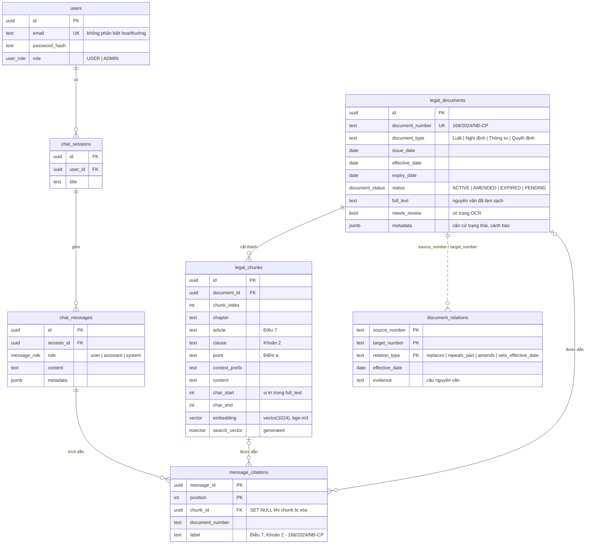

# Database (Task 1.4)

PostgreSQL 17 + `pgvector`. Schema được quản lý bằng migration SQL thuần trong `migrations/`, chạy
bằng [dbmate](https://github.com/amacneil/dbmate). Cả `libris-api` (NestJS) và `libris-ai`
(FastAPI) dùng chung database này; mọi thay đổi schema đều đi qua một migration mới tại đây.

## Chạy migration

```bash
docker compose up -d --wait            # PostgreSQL + Redis
docker compose run --rm migrate        # áp dụng migration chưa chạy, cập nhật db/schema.sql
docker compose run --rm migrate status
docker compose run --rm migrate rollback   # hoàn tác migration gần nhất
docker compose run --rm migrate new <ten_migration>   # tạo file migration mới
```

`schema.sql` là bản dump schema hiện tại, do dbmate tự sinh. Đừng sửa tay; hãy commit cùng
migration để review.

## Nạp dữ liệu văn bản

```bash
cd libris-ai
uv run python -m crawler normalize     # -> data/catalog.json
uv run python -m crawler load-db       # -> legal_documents, document_relations
```

## Sơ đồ



## Bảng bổ sung

- `superseded_provisions` (Task 3.2): Điều/Khoản của một văn bản bị văn bản khác bãi bỏ hoặc thay
  nội dung, kèm `effective_date` và câu nguyên văn làm căn cứ. Hybrid Search dùng bảng này để loại
  các đoạn luật đã hết hiệu lực dù văn bản chứa chúng vẫn còn hiệu lực một phần. `clause = ''`
  nghĩa là cả Điều.

## Quyết định thiết kế

- **Trạng thái hiệu lực nằm ở `legal_documents.status`.** Task 3.2 lọc
  `JOIN legal_documents ... WHERE status IN ('ACTIVE','AMENDED')`. Truy vấn so sánh luật cũ và
  mới thì mở rộng sang `EXPIRED`. `document_relations` cho Query Router biết văn bản nào thay thế
  văn bản nào.
- **`document_relations` dùng số hiệu, không dùng khóa ngoại**, vì văn bản đích (VD: Luật Đất đai
  2003) có thể chưa có trong kho.
- **`legal_chunks.char_start/char_end`** trỏ vào `legal_documents.full_text`, để Citation Viewer
  (Task 4.3) bôi vàng đúng đoạn được dẫn. Khi nạp lại một văn bản có nguyên văn thay đổi, loader
  tự xóa các chunk cũ của văn bản đó.
- **`search_vector` là cột generated** với cấu hình `simple`, giữ nguyên dấu tiếng Việt
  ("đất" ≠ "đặt") và luôn đồng bộ với `content`.
- **Chỉ mục HNSW (embedding) và GIN (search_vector) tạo ở Task 2.2**, sau khi nạp dữ liệu. Dựng
  HNSW một lần trên dữ liệu có sẵn nhanh hơn nhiều so với cập nhật dần khi chèn.
- **`message_citations` lưu lại `document_number` và `label`**, đồng thời `chunk_id` chuyển thành
  `NULL` khi chunk bị cắt lại. Nhờ vậy lịch sử hội thoại cũ vẫn hiển thị đúng trích dẫn.

## Lưu ý khi cắt `full_text` bằng SQL

`full_text` của văn bản dài được PostgreSQL nén (TOAST). Với cột nén, `substr(full_text, s, n)`
chỉ giải nén một lát byte, và có thể báo lỗi `invalid byte sequence for encoding "UTF8"` khi lát
đó cắt ngang một ký tự tiếng Việt nhiều byte. Lỗi đã được tái hiện trên PostgreSQL 17.8; dữ liệu
không hề sai.

Để lấy nguyên văn một đoạn luật, hãy dùng `legal_chunks.content` (đã bằng đúng
`full_text[char_start:char_end]`). Nếu buộc phải cắt trong SQL, ép giải nén toàn bộ trước:

```sql
SELECT substr(d.full_text || '', c.char_start + 1, c.char_end - c.char_start)
FROM legal_chunks c JOIN legal_documents d ON d.id = c.document_id;
```

Lưu ý thêm: `char_start`/`char_end` tính theo **ký tự** (code point), không theo byte. Phía
JavaScript (Task 4.3) cần cắt theo code point (`Array.from(text)`), vì `String.slice` đếm theo
UTF-16.

