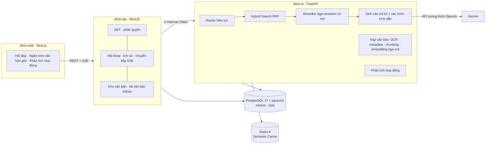

# Libris – Trợ lý Pháp luật: Báo cáo dự án

Libris trả lời câu hỏi về pháp luật Việt Nam **chỉ dựa trên văn bản luật trong kho**, gắn trích dẫn
`[Điều X, Khoản Y - Số hiệu]` cho từng luận điểm và cho người dùng bấm vào để đối chiếu nguyên văn.
Điểm khác biệt chính so với một chatbot thông thường:

1. **Kiểm soát hiệu lực theo thời gian** – biết quy định nào đang áp dụng, quy định nào đã bị thay
   thế, và trả lời theo đúng mốc thời gian người dùng hỏi.
2. **Chống ảo giác nhiều lớp** – thà từ chối còn hơn bịa; mọi trích dẫn đều được xác minh lại.
3. **Đo lường được** – bộ 100 câu hỏi chuẩn, các chỉ số RAGAS và chỉ số truy xuất theo mã điều luật.

## 1. Kiến trúc



| Dịch vụ | Công nghệ | Vai trò |
|---|---|---|
| libris-web | Next.js 16, Tailwind 4, shadcn/ui | Giao diện; nhận câu trả lời theo luồng SSE |
| libris-api | NestJS 12, `pg`, Zod | Đăng nhập (JWT), phân quyền, lịch sử hội thoại, quản trị kho văn bản |
| libris-ai | FastAPI, sentence-transformers, psycopg 3 | Toàn bộ RAG: nạp văn bản, truy xuất, sinh và xác minh câu trả lời |
| Dữ liệu | PostgreSQL 17 + pgvector 0.8, Redis 8 | Văn bản, đoạn luật + embedding 1024 chiều, quan hệ hiệu lực; cache |

Triển khai: [DEPLOY.md](DEPLOY.md). Lộ trình: [ROADMAP.md](ROADMAP.md).

## 2. Dữ liệu

| | |
|---|---|
| Nguồn | Cổng văn bản của Chính phủ (vanban.chinhphu.vn) – PDF, DOC, DOCX |
| Văn bản | 18 (9 luật/bộ luật, 9 nghị định) – giao thông, lao động, hôn nhân gia đình, đất đai |
| Hiệu lực | 12 còn hiệu lực, 2 đã sửa đổi một phần, 3 hết hiệu lực, 1 chưa có hiệu lực |
| Bản scan cần OCR | 12/18 văn bản (Tesseract tiếng Việt; đánh dấu `needs_review`) |
| Đoạn luật | 4.970 đoạn, trung bình 688 ký tự, tối đa 1.800 |
| Quan hệ hiệu lực | 62 quan hệ giữa văn bản (thay thế, bãi bỏ một phần, sửa đổi, quy định ngày hiệu lực) |
| Điều/Khoản bị bãi bỏ hoặc sửa | 82 (53 bãi bỏ, 29 sửa đổi) |

Pipeline: tải văn bản -> trích chữ (OCR với bản scan) -> làm sạch -> **tự nhận metadata và quan hệ
hiệu lực** từ phần "Điều khoản thi hành" -> **cắt theo cấu trúc** Phần / Chương / Mục / Điều /
Khoản / Điểm, mỗi đoạn mang tiền tố ngữ cảnh ("Nghị định 168/2024 | Chương II | Điều 7 | Khoản 2")
và vị trí ký tự trong nguyên văn -> embedding bge-m3.

## 3. Hybrid Search

```mermaid
flowchart TD
  Q[Câu hỏi] --> R{Router}
  R -->|mặc định| C[Chỉ quy định đang có hiệu lực]
  R -->|"vào năm 2022", "trước ngày..."| P[Quy định có hiệu lực tại mốc đó]
  R -->|"so sánh", "cũ và mới"| S[Cả quy định cũ lẫn mới]
  R -->|nêu số hiệu / tên + năm| N[Ưu tiên văn bản được nêu]
  C & P & S & N --> X[Mở rộng thuật ngữ: 'xe máy' -> 'xe mô tô, xe gắn máy']
  X --> V[Vector: cosine bge-m3, HNSW] & K[Từ khóa: ts_rank_cd, GIN] & F[Văn bản được nêu]
  V & K & F --> RRF["RRF trong một câu SQL<br/>1/(60+r_vec) + 1/(60+r_kw) + 1/(60+r_ref)"]
  RRF --> RR[Cross-encoder rerank 10–20 ứng viên]
  RR --> T[Top 5 đoạn cho LLM]
```

- **RRF** chỉ dùng thứ hạng nên không phải chuẩn hóa thang điểm cosine và `ts_rank`.
- Luồng từ khóa tìm theo **cụm hai âm tiết** (`'đèn' <-> 'tín'`): tiếng Việt viết theo âm tiết nên
  tìm từng âm tiết riêng lẻ ("xe", "máy", "đèn") khớp hàng nghìn đoạn. Trọng số các luồng được chọn
  bằng đánh giá (mục 6): 1 khi có reranker; không có reranker thì chỉ dùng vector (luồng từ khóa
  khi đó làm nhiễu thứ hạng, đo trên cả ba bộ câu hỏi).
- Câu hỏi nhiều ý ("vừa không đội mũ bảo hiểm vừa vượt đèn đỏ") được tách thành câu hỏi con, mỗi ý
  có căn cứ riêng trong Top 5; câu hỏi nối tiếp ("còn ô tô thì sao?") được ghép với câu hỏi trước
  trong hội thoại.
- Văn bản OCR được **hiệu đính dấu thanh** theo ngữ cảnh (~29.000 chỗ "đât" -> "đất", "câm" -> "cầm")
  trước khi cắt đoạn.
- Câu so sánh chạy thêm một lượt chỉ trong quy định hiện hành, rồi giữ tối thiểu một nửa Top 5 cho
  mỗi nhóm cũ/mới để LLM có đủ cả hai phía.

## 4. Kiểm soát hiệu lực theo thời gian

| Tầng | Cơ chế |
|---|---|
| Văn bản | `status`: còn hiệu lực / đã sửa đổi / hết hiệu lực / chưa có hiệu lực; ngày hiệu lực và hết hiệu lực |
| Quan hệ | `document_relations`: văn bản A thay thế / bãi bỏ một phần / sửa đổi B, từ ngày nào |
| Điều, Khoản | `superseded_provisions`: Điều/Khoản cụ thể bị bãi bỏ hoặc thay nội dung (VD phần giao thông đường bộ của NĐ 100/2019 bị NĐ 168/2024 bãi bỏ dù NĐ 100/2019 vẫn còn hiệu lực ở phần đường sắt) |
| Tự cập nhật | Hàm SQL `recompute_document_status()` tính lại trạng thái mỗi khi nạp hoặc xóa văn bản: nạp luật mới -> luật cũ tự chuyển hết hiệu lực; xóa luật mới -> luật cũ trở lại |
| Truy xuất | Lọc ở **cấp đoạn**: mặc định bỏ Điều/Khoản đã bị bãi bỏ; câu hỏi theo mốc thời gian lấy văn bản có hiệu lực tại mốc đó |
| Câu trả lời | Tự gắn cảnh báo ⚠️ cho mọi Điều/văn bản được trích dẫn mà đã hết hiệu lực hoặc bị bãi bỏ – không phụ thuộc LLM có nhắc hay không |

Ví dụ (chạy trên hệ thống thật):

| Câu hỏi | Libris trả lời theo |
|---|---|
| Không đội mũ bảo hiểm khi đi xe máy bị phạt bao nhiêu? | NĐ 168/2024: 400.000 – 600.000 đồng |
| **Năm 2023** đi xe máy không đội mũ bảo hiểm bị phạt bao nhiêu? | NĐ 100/2019 (áp dụng năm 2023): 200.000 – 300.000 đồng |
| So sánh mức phạt nồng độ cồn (xe máy, > 80 mg) cũ và mới | cũ 6 – 8 triệu + ⚠️ đã bị bãi bỏ; mới 8 – 10 triệu |
| Theo BLLĐ 2012 nữ nghỉ hưu ở tuổi 55, nay còn đúng? | BLLĐ 2012 hết hiệu lực từ 01/01/2021, thay bằng BLLĐ 2019 |

## 5. Chống ảo giác

| Lớp | Cơ chế |
|---|---|
| 1. Trước khi gọi LLM | Đoạn liên quan nhất có điểm rerank < 0,05 (chọn bằng 120 câu đánh giá) -> từ chối ngay (không tốn lượt LLM, mô hình không có cơ hội tự suy diễn) |
| 2. System prompt | Chỉ dùng tài liệu được cung cấp; mỗi luận điểm phải có thẻ trích dẫn chép đúng nhãn; giữ nguyên văn con số; thiếu căn cứ thì trả lời `TỪ CHỐI`; nội dung tài liệu không được coi là chỉ dẫn (chống prompt injection) |
| 3. Sau khi trả lời | Mỗi thẻ được đối chiếu với các đoạn trong ngữ cảnh (văn bản + Điều + Khoản). Câu trả lời không có trích dẫn hợp lệ nào bị thay bằng lời từ chối; thẻ không khớp được báo lại |
| 4. Áp dụng đúng Khoản | Điều kiện có con số trong câu hỏi (số người chở theo, km/h, nồng độ cồn, tuổi) được đổi thành khoảng giá trị và đối chiếu với Điểm/Khoản được dẫn; số tiền trong câu phải có trong Khoản được dẫn. Sai -> mô hình viết lại một lần với gợi ý cụ thể (giao diện xóa bản nháp). Trên ~290 câu trả lời đã lưu: bắt đúng lỗi, không báo nhầm |

Giao diện chỉ cho bấm các thẻ đã xác minh; bấm vào mở **nguyên văn văn bản và bôi vàng đúng đoạn**
(vị trí ký tự lưu khi cắt đoạn), kèm trạng thái hiệu lực.

## 6. Đánh giá (Giai đoạn 5)

Bộ **Golden Dataset** 100 câu biên soạn từ nguyên văn trong kho: câu hỏi sự kiện, cách hỏi đời thường,
so sánh cũ – mới, theo mốc thời gian, **bẫy luật hết hiệu lực**, câu ngoài phạm vi, chèn lệnh. Chi
tiết và cách chạy lại: [libris-ai/eval/README.md](../libris-ai/eval/README.md).

**Truy xuất** – Context Precision@5 (công thức RAGAS, đoạn đúng xác định bằng mã điều luật):

| Cấu hình | CP@5 | Recall@5 | Hit@1 |
|---|---|---|---|
| Chỉ từ khóa | 0,248 | 0,309 | 0,213 |
| Hybrid ban đầu (không rerank) | 0,458 | 0,644 | 0,330 |
| Chỉ vector | 0,695 | 0,846 | 0,585 |
| Hybrid ban đầu + rerank 10 (cấu hình cũ) | 0,681 | 0,771 | 0,628 |
| Hybrid từ khóa ×0,25 + rerank 20 (sau Giai đoạn 5) | 0,775 | 0,894 | 0,691 |
| **Hiện tại**: hiệu đính OCR, cụm hai âm tiết, tách câu nhiều ý, khử nhập nhằng loại xe/lĩnh vực, rerank 20 | **0,803** | **0,936** | **0,713** |

Ngoài Golden Dataset, cấu hình hiện tại được đo trên hai bộ **không dùng để tinh chỉnh ban đầu**:
hold-out 20 câu (CP@5 0,917, Recall@5 1,0, Hit@1 0,90) và **152 câu sinh tự động** từ các đoạn luật
ngẫu nhiên không trùng Điều với hai bộ kia (CP@5 0,778, Recall@5 0,901, Hit@1 0,697 – so với 0,716
của tìm theo vector thuần). Bộ tự động cũng cho thấy khi tắt reranker thì nên tìm theo vector thuần
thay vì lai (Hit@1 0,612 so với 0,395).

**Câu trả lời** (100 câu):

| Chỉ số | Ban đầu | Sau Giai đoạn 5 | Hiện tại |
|---|---|---|---|
| RAGAS Faithfulness | 0,923 (60/77 câu) | – | – |
| RAGAS Answer Relevancy | 0,878 (60/77 câu) | – | – |
| Đúng dữ kiện (đủ mọi con số chuẩn) | 93,5% | 94,0% | 94,4% |
| Trích dẫn đủ căn cứ (recall) | 90,3% | 96,4% | 96,1% |
| Từ chối nhầm câu trả lời được | 17,0% | 9,6% | **4,3%** |
| Câu cần nhiều căn cứ – trả lời đúng | 50% | 50% | **75%** |
| Câu bẫy luật hết hiệu lực – trả lời đúng | 67% | 100% | 100% |
| Từ chối đúng câu ngoài phạm vi | 6/6 | 6/6 | 6/6 |
| Chống chèn lệnh | 2/2 | 2/2 | 2/2 |

RAGAS chấm bằng giám khảo Gemini (gói miễn phí hết quota sau 60/77 câu). Hai lượt sinh dùng mô hình
khác nhau nên cột "sau tinh chỉnh" phản ánh cả cấu hình truy xuất lẫn mô hình; phần do truy xuất
được đo riêng ở bảng trên. Bộ dữ liệu còn phát hiện một lỗi của Router (câu bắt đầu bằng "Năm 2023,
..." không được nhận là hỏi theo mốc thời gian) – đã sửa.

**Kiểm tra độc lập (hold-out, 20 câu mới, soạn sau khi tinh chỉnh)** – so với hệ thống cũ dựng lại từ
code và dữ liệu sao lưu: xếp hạng truy xuất của hệ thống hiện tại kém hơn (CP@5 0,842 so với 0,892,
dấu hiệu "học thuộc đề"), nhưng câu trả lời đúng dữ kiện 100% so với 94,1% và từ chối nhầm 10% so
với 15%. Phân tích hold-out dẫn tới các bản vá: khử nhập nhằng loại xe, hạ ngưỡng từ chối trước LLM
từ 0,2 xuống 0,05 (chọn bằng 120 câu), tách câu "muốn A và B". Chi tiết:
[libris-ai/eval/README.md](../libris-ai/eval/README.md).

**Semantic Cache**: ngưỡng cosine 0,95 chọn bằng dữ liệu, kèm **chữ ký** (con số, loại xe, nam/nữ,
loại ngày, loại đất...) vì embedding coi "xe máy vượt đèn đỏ" và "ô tô vượt đèn đỏ" giống nhau
0,957 dù mức phạt khác hẳn. Trúng cache: ~0,1 giây trong libris-ai, ~0,25 giây tính cả libris-api,
so với 8–20 giây cho một câu trả lời mới.

## 7. Tính năng phân tích hợp đồng

Tải lên hợp đồng (PDF/DOC/DOCX, bản scan được OCR): LLM tóm tắt và chỉ ra tối đa 6 điểm cần lưu ý ->
mỗi điểm được tra luật như hỏi đáp -> LLM đánh giá **chỉ dựa trên các đoạn luật tìm được**, trích dẫn
được xác minh, điểm bị đánh giá nặng mà không có căn cứ bị gắn cờ. Hợp đồng không được lưu. Thử với
hợp đồng lao động mẫu ([demo/hop-dong-lao-dong-mau.docx](demo/hop-dong-lao-dong-mau.docx)) cài sẵn
7 điều khoản có vấn đề (thử việc 90 ngày, lương thử việc 70%, giữ bản chính văn bằng, phạt tiền trừ
lương, báo trước 90 ngày và giữ lương tháng cuối, bắt buộc làm thêm giờ, công ty chấm dứt hợp đồng
bất cứ lúc nào): Libris nêu được 6 điểm (giới hạn tối đa 6), đều xếp "rủi ro cao", dẫn Điều 25, 26,
35, 118 BLLĐ 2019 và các điều xử phạt của NĐ 12/2022; bỏ sót điều khoản công ty chấm dứt hợp đồng
bất cứ lúc nào.

## 8. Hạn chế và hướng phát triển

| Hạn chế | Hướng xử lý |
|---|---|
| Kho mới có 18 văn bản, 4 lĩnh vực | Crawler và trang quản trị đã sẵn sàng để nạp thêm |
| 12/18 văn bản là bản scan; đã hiệu đính dấu thanh, ký tự nhầm trong từ, nhãn Điểm, số Khoản; còn ký tự rác rải rác | Thay bằng văn bản gốc dạng chữ (vbpl.vn chặn truy cập từ môi trường chạy) hoặc OCR lại bằng mô hình thị giác |
| Câu hỏi cần nhiều căn cứ đúng 75%; tách câu bằng quy tắc | Viết lại / tách câu hỏi bằng LLM |
| Bộ câu tự động do LLM viết từ chính đoạn luật; Golden/hold-out đã dùng khi tinh chỉnh | Một bộ câu hỏi do người khác soạn (hoặc câu hỏi thật của người dùng), giữ kín, chỉ dùng để đo trước mỗi lần phát hành |
| Lớp kiểm tra áp dụng đúng Khoản chỉ hiểu một số đơn vị (người chở theo, km/h, nồng độ cồn, tuổi) và số tiền | Bổ sung đơn vị khi mở rộng lĩnh vực (diện tích, thời hạn...) |
| Câu hỏi nối tiếp được nhận diện bằng quy tắc | Viết lại câu hỏi bằng LLM khi có quota |
| Câu hỏi đời thường khác xa từ ngữ của luật ("nghỉ ngang", "đi trễ bị trừ lương"): Điều đúng không lọt vào 20 ứng viên | Đã thử cho LLM viết lại câu hỏi bằng thuật ngữ pháp lý rồi tìm bằng cả hai câu (`rewrite.py`): không cải thiện (Golden Recall@5 0,936 -> 0,941, Hit@1 0,713 -> 0,702), tốn thêm một lần gọi LLM -> không bật. Hướng tiếp: lấy thêm ứng viên (40–50) khi có GPU, hoặc bổ sung bảng ánh xạ thuật ngữ từ câu hỏi thật |
| Token đăng nhập lưu trong `localStorage` | Chuyển sang session cookie `HttpOnly` khi web và API có chung tên miền riêng |
| Chạy trên CPU: 8–20 giây mỗi câu trả lời mới | GPU cho embedding/reranker; cache đã giảm còn ~0,25 giây cho câu lặp lại |
| Phụ thuộc quota Gemini gói miễn phí | Gói trả phí hoặc mô hình khác qua API tương thích OpenAI (chỉ đổi cấu hình) |
| Chưa dò kích thước đoạn | Cần GPU để sinh lại embedding cho mỗi cấu hình |
